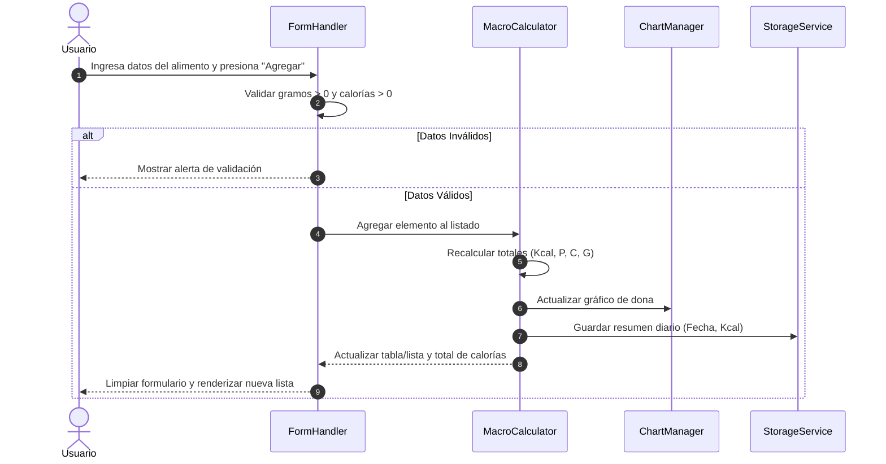
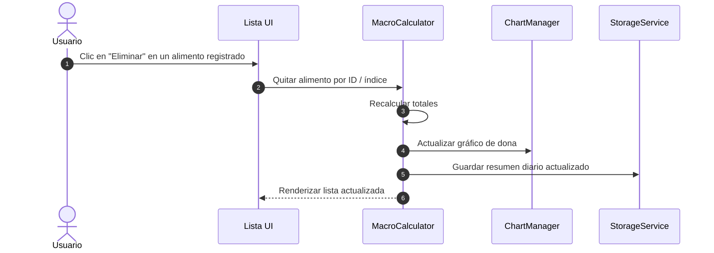

# Documento de Diseño

## Resumen

Este documento define la arquitectura técnica y el diseño de componentes para la Calculadora de Macros y Calorías (`calculadora-macros-comida`). La solución es una aplicación web Single-Page Application (SPA) cliente sin backend, basada en HTML5, CSS3 y JavaScript vanilla, integrada con Chart.js vía CDN para visualización gráfica y `localStorage` para almacenamiento persistente del resumen diario.

## Arquitectura

Se utiliza un patrón MVC simplificado ejecutado totalmente en el navegador del cliente:

```
+-------------------------------------------------------+
|                    Interfaz de Usuario (HTML/CSS)     |
+--------------------------+----------------------------+
                           |
                           v
+-------------------------------------------------------+
|                 Controlador (app.js)                  |
|  - Captura de eventos UI                              |
|  - Orquestación de flujos                             |
+------------+--------------------+---------------------+
             |                    |
             v                    v
+-----------------------+  +----------------------------+
|  MacroCalculator      |  |  ChartManager              |
|  - Cálculo de kcal    |  |  - Renderizado Chart.js    |
|  - Validación reglas  |  |  - Actualización dona      |
+------------+----------+  +----------------------------+
             |
             v
+-------------------------------------------------------+
|  StorageService                                       |
|  - Persistencia en LocalStorage (Fecha + Kcal)        |
+-------------------------------------------------------+
```

## Componentes

### 1. FormHandler (`app.js` / UI)
- Captura las entradas del usuario (alimento, gramos, calorías, proteínas, carbohidratos, grasas).
- Asigna la fecha actual por defecto.
- Valida que gramos y calorías sean valores numéricos estrictamente mayores a cero antes de procesar.

### 2. MacroCalculator
- Mantiene el arreglo de alimentos registrados en la sesión activa.
- Calcula totales acumulados de calorías, proteínas, carbohidratos y grasas.
- Ejecuta la lógica para agregar y eliminar alimentos.

### 3. ChartManager
- Inicializa la instancia del gráfico circular (dona) de Chart.js en un elemento `<canvas>`.
- Actualiza los datos de las series (Proteínas, Carbohidratos, Grasas) de manera dinámica mediante `chart.update()`.

### 4. StorageService
- Lee y escribe en `localStorage` usando la clave `macro_summary_<YYYY-MM-DD>`.
- Estructura de almacenamiento mínima: fecha y total acumulado de calorías.

## Flujos

### Flujo 1: Agregar Alimento



### Flujo 2: Eliminar Alimento



## Modelo de Datos

### Objeto `FoodItem` (En memoria)

```json
{
  "id": "string (timestamp)",
  "nombre": "string",
  "gramos": "number (> 0)",
  "calorias": "number (> 0)",
  "proteinas": "number (>= 0)",
  "carbohidratos": "number (>= 0)",
  "grasas": "number (>= 0)"
}
```

### Objeto `DailySummary` (LocalStorage)

```json
{
  "fecha": "YYYY-MM-DD",
  "totalCalorias": "number"
}
```

## Interfaces e Integraciones

- **Chart.js CDN:** Inclusión directa en HTML a través del Script Tag:
  `https://cdn.jsdelivr.net/npm/chart.js`
- **LocalStorage API:** Interfaz nativa del navegador mediante `localStorage.getItem()` y `localStorage.setItem()`.

## Manejo de Errores

1. **Ingreso de Gramos o Calorías <= 0:**
   - Precondición: Se evalúa antes de la inserción.
   - Respuesta: Se bloquea el evento `submit`, se marca el campo con estilo visual de error y se presenta un mensaje explicativo en la interfaz.
2. **Falta de soporte de LocalStorage:**
   - Captura mediante `try...catch` al intentar acceder a `window.localStorage`.
   - Si no está disponible, la aplicación mantendrá el estado en memoria durante la sesión activa.

## Seguridad

- Sanitización de la entrada del nombre del alimento (`textContent` o escape de caracteres especiales) para prevenir inyección de scripts XSS al renderizar la tabla/lista de elementos.

## Observabilidad

- Logs informativos en la consola del navegador (`console.log`) en entorno de desarrollo para registrar eventos de agregación, eliminación e interacción con el almacenamiento local.

## Estrategia de Pruebas

- Pruebas unitarias sobre la lógica de `MacroCalculator` (suma de totales y filtros de eliminación).
- Pruebas de integración sobre la sincronización entre los datos del modelo, el DOM y la instancia de `Chart.js`.

## Decisiones y Alternativas

- **Chart.js en lugar de Canvas API nativa:** Reduce drásticamente la complejidad del desarrollo y las líneas de código necesarias para manipular la animación y proporciones de la dona.
- **LocalStorage en lugar de IndexedDB:** Mantiene la persistencia ultra liviana para el MVP, cumpliendo estrictamente los requisitos definidos sin añadir bibliotecas ni abstracciones complejas.

## Trazabilidad con Requisitos

| Requisito | Componente Principal | Criterio Cubierto |
|---|---|---|
| Requisito 1 | FormHandler / MacroCalculator | 1.1, 1.2, 1.3 |
| Requisito 2 | ChartManager | 2.1, 2.2 |
| Requisito 3 | StorageService | 3.1, 3.2, 3.3 |
| Requisito 4 | MacroCalculator / UI | 4.1, 4.2 |
